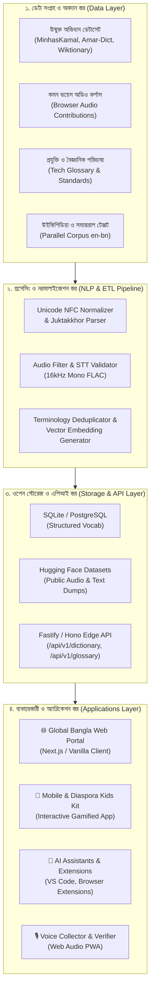

# 🏗️ গ্লোবাল বাংলা সিস্টেম আর্কিটেকচার (System Architecture)

গ্লোবাল বাংলা (Global Bangla) একটি বহুস্তরীয় ওপেন সোর্স ইকোসিস্টেম। এখানে কাঁচা ডেটাসেট (Raw Data) সংগ্রহ থেকে শুরু করে প্রি-প্রসেসিং, এআই মডেল ট্রেনিং এবং এন্ড-ইউজার অ্যাপ্লিকেশন পর্যন্ত সামগ্রিক প্রযুক্তিগত পাইপলাইনকে মডুলার ও স্কেলেবলভাবে ডিজাইন করা হয়েছে।

---

## 🧩 সামগ্রিক আর্কিটেকচার ওভারভিউ (High-Level Architecture)

---

## 🔬 স্তরভিত্তিক প্রযুক্তি বিবরণ (Layer Breakdown)

### ১. ডেটা সংগ্রহ স্তর (Data Contribution Layer)
- **অভিধান ডেটা:** ওপেন সোর্স গিটহাব রিপোজিটরি ও উইকিশনারি থেকে স্ক্র্যাপ ও ক্লিনড ডেটা (JSON / CSV)।
- **স্পিচ ডেটা:** HTML5 Web Audio API ব্যবহার করে সরাসরি ব্রাউজার থেকে ১৬kHz মনো WAV/FLAC অডিও সংগ্রহ।
- **পরিভাষাকোষ ডেটা:** কমিউনিটি কন্ট্রিবিউটর ও প্রযুক্তি লেখকদের যাচাইকৃত টেকনিক্যাল টার্মস।

### ২. এনএলপি ও ডেটা প্রসেসিং পাইপলাইন (Processing Pipeline)
- **Bangla NFC Normalizer:** যুক্তবর্ণের অপ্রমিত কোডপয়েন্ট এবং কার-চিহ্নের ক্রম প্রমিতকরণ।
- **Audio Verification Pipeline:** শব্দদূষণ মুক্তকরণ এবং স্বেচ্ছাসেবকদের ভোটিংয়ের মাধ্যমে শব্দের মান নিশ্চিতকরণ।
- **Vector Embeddings:**语义গত অনুসন্ধান (Semantic Search) ও সমার্থক শব্দ খোঁজার জন্য এআই এমবেডিং প্রস্তুত।

### ৩. স্টোরেজ ও পাবলিক এপিআই (Storage & Edge API)
- **পাবলিক ডেটাসেট হোস্ট:** ডেটাসেটগুলো Hugging Face এবং Zenodo-তে স্থায়ী DOI সহ হোস্ট করা হবে যাতে বিশ্বব্যাপী এআই গবেষকগণ সহজে ডাউনলোড করতে পারেন।
- **এজ এপিআই (Edge API):** ক্লাউডফ্লেয়ার ওয়ার্কার্স বা ভার্সেল এজে চালিত অতি-দ্রুতগতির লো-লেটেন্সি এপিআই যাতে কোনো লোকাল অ্যাপ্লিকেশন কয়েক মিলিসেকেন্ডেই বাংলা শব্দের অর্থ ও উচ্চারণ পেতে পারে।

### ৪. অ্যাপ্লিকেশন স্তর (Application Layer)
- **ওয়েব পোর্টাল:** বিশ্বজুড়ে বাঙালি ও শিক্ষার্থীদের তথ্য এবং টুলস প্রদানকারী সেন্ট্রাল ড্যাশবোর্ড।
- **কিডস ও লার্নিং টুলস:** শব্দ শেখার গেম ও অ্যানিমেটেড শিক্ষামূলক প্ল্যাটফর্ম।
- **ডেভেলপার প্লাগইন:** ভিএস কোড ও ব্রাউজারে সরাসরি বাংলা প্রযুক্তি পরিভাষা দেখার টুল।
